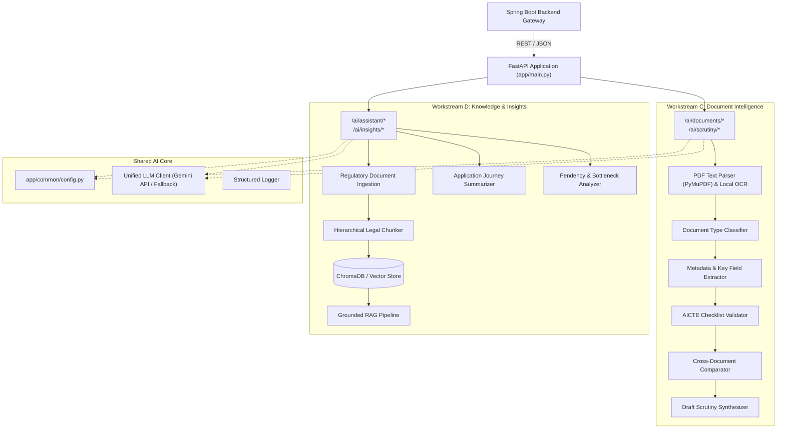

# NiyamPath — AI Intelligence Architecture Specification (Workstreams C & D)

> **Tech Stack:** Python 3.11+, FastAPI, Pydantic v2, PyMuPDF, pdfplumber, Tesseract OCR, Gemini API, ChromaDB, Sentence Transformers.  
> **Target Port:** 8000  
> **Directory Boundary:** `/ai-service`

---

## 1. Unified Architecture for Two Workstreams

To eliminate duplicate runtimes while maintaining independent ownership, Workstreams C and D share a single FastAPI application with modular sub-packages:

---

## 2. Workstream C: Document Intelligence Pipeline

1. **Document Ingestion & Pre-processing:**
   - Ingests uploaded PDF documents (e.g. land titles, registered leases, structural safety certificates).
   - Uses `PyMuPDF` (`fitz`) for digital vector text extraction.
   - Falls back to `pdfplumber` / `pytesseract` for scanned image pages.
2. **Classification & Entity Extraction:**
   - Classifies document into approved AICTE categories (`LAND_TITLE`, `LEASE_DEED`, `BUILDING_SAFETY_CERTIFICATE`, `FIRE_SAFETY_CERTIFICATE`, `AFFIDAVIT_UNDERTAKING`).
   - Extracts structured key-value pairs: Institution Name, Document Date, Expiry Date, Land Area (Acres), Issuing Authority, Registration / Reference Number.
3. **Checklist & Discrepancy Analysis:**
   - Compares extracted fields against mandatory requirements.
   - Cross-checks values between documents (e.g. institution address on lease deed vs application form).
4. **Draft Scrutiny Generation:**
   - Generates evidence-grounded preliminary observations formatted for the officer's scrutiny dashboard.

---

## 3. Workstream D: Knowledge Intelligence & Insights Pipeline

1. **Regulatory Document Ingestion & Chunking:**
   - Ingests official AICTE guidelines (e.g. Approval Process Handbook excerpts).
   - Implements semantic hierarchical chunking preserving Chapter, Section, and Appendix metadata.
2. **Dense Vector Embeddings & Hybrid Search:**
   - Generates vector embeddings stored in a local ChromaDB instance.
   - Employs cosine similarity with metadata filtering.
3. **Grounded RAG Regulatory Assistant:**
   - Synthesizes answers strictly from retrieved regulatory chunks.
   - Appends mandatory citations (`document`, `chapter`, `section`, `page`).
   - If retrieved context does not contain the answer, explicitly returns: `"The approved AICTE knowledge base does not contain this information."`
4. **Application Summarization & Pendency Insights:**
   - Generates executive summaries of complex multi-stage applications.
   - Computes stage ageing metrics and identifies review bottlenecks based on platform data.

---

## 4. Strict AI Guardrails

- **Zero Autonomous Execution:** The AI service exposes no database mutation APIs. All endpoints return data structures for officer review.
- **Hallucination Prevention:** Temperature is strictly constrained ($T \le 0.2$) for regulatory and scrutiny operations.
- **Source Citation Enforcement:** Every answer generated by the Regulatory Assistant must cite its exact source document and section.

