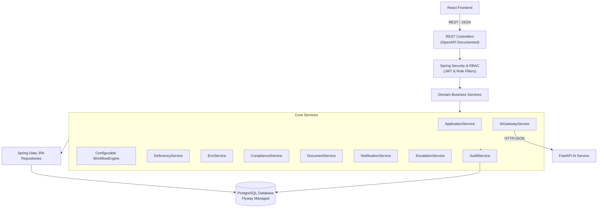

# NiyamPath — Core Backend Architecture Specification (Workstream B)

> **Tech Stack:** Java 17/21, Spring Boot 3.3.x, Spring Data JPA, Spring Security, PostgreSQL 16, Flyway, OpenAPI 3.  
> **Target Port:** 8080  
> **Package Namespace:** `org.algorise.niyampath`  
> **Directory Boundary:** `/backend`

---

## 1. Architectural Overview

The Core Backend serves as the authoritative source of truth for all business rules, regulatory lifecycles, and security enforcement across NiyamPath.



---

## 2. Package Architecture

```
backend/src/main/java/org/algorise/niyampath/
├── config/
│   ├── AppConfig.java              # General beans (Clock, ModelMapper/ObjectMapper)
│   ├── CorsConfig.java             # CORS mappings for frontend (localhost:5173)
│   ├── OpenApiConfig.java          # Swagger OpenAPI documentation metadata
│   └── SecurityConfig.java         # Spring Security chain, RBAC rules, CSRF
├── security/
│   ├── JwtTokenProvider.java       # JWT creation, parsing, and signing
│   ├── JwtAuthenticationFilter.java# Bearer token validation filter
│   ├── CustomUserDetailsService.java
│   └── SecurityUtils.java          # Helper to extract active user/role context
├── common/
│   ├── BaseAuditableEntity.java    # Base class with created_at, updated_at
│   ├── ApiResponse.java            # Standard success response wrapper
│   ├── ErrorResponse.java          # Standard error response wrapper
│   └── GlobalExceptionHandler.java # @ControllerAdvice handling exceptions
├── user/                           # User, Role, Permission entities & APIs
├── institution/                    # Educational Institution profiles
├── application/                    # Application entity, state transitions, APIs
├── workflow/                       # WorkflowTemplate, WorkflowStage, WorkflowEngine
├── deficiency/                     # Deficiency, DeficiencyCycle, Scrutiny APIs
├── evc/                            # EVCCommittee, EVCMember, EVCSchedule, InspectionReport
├── compliance/                     # ComplianceRequirement, Undertaking, Evidence
├── document/                       # DocumentMetadata, DocumentVersion, Expiry logic
├── notification/                   # In-app notifications & priority queues
├── escalation/                     # SLA monitoring & escalation triggers
├── analytics/                      # Workload, pendency, and ageing calculation
├── audit/                          # AuditEvent entity, repository, and AuditService
└── ai/                             # WebClient to FastAPI AI service & AI record logging
```

---

## 3. Workflow Engine & State Machine

1. **Configurable Templates:** Applications are instantiated with a reference to a `WorkflowTemplate` (e.g. `ROUTE-SCRUTINY-EVC`).
2. **Transition Validation:** When a stage transition is requested (`PATCH /api/applications/{id}/stage`), the `WorkflowEngine` queries `workflow_stages` for the template and validates whether `currentStage -> targetStage` is permitted.
3. **Deficiency Loop:** If deficiencies are raised during scrutiny, the application status transitions to `DEFICIENCY_RAISED`. The application remains in `SCRUTINY` stage until all open deficiencies are marked `RESOLVED`.
4. **Audit Emission:** Any transition automatically writes a `workflow_history` record and an `audit_events` row.

---

## 4. AI Gateway & Human Governance

- The `AiGatewayService` acts as an outbound client (via Spring `RestClient` or `WebClient`) to the Python FastAPI AI service (`http://localhost:8000`).
- The backend scrubs unnecessary PII before sending document text or application records to the AI service.
- The returned AI analysis is stored in `ai_analysis_records` with status `PENDING_REVIEW`.
- Only an authorized `CENTRAL_OFFICER` can promote an AI observation into an official deficiency.

