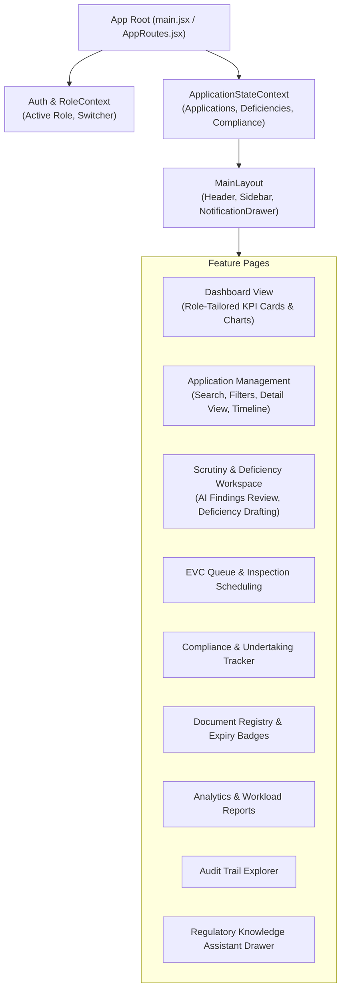

# NiyamPath — Frontend Architecture Specification (Workstream A)

> **Tech Stack:** React 18, Vite, JavaScript, Tailwind CSS, React Router DOM, Recharts, Lucide React.  
> **Target Port:** 5173  
> **Directory Boundary:** `/frontend`

---

## 1. Architectural Overview

The NiyamPath frontend provides a single, cohesive Single Page Application (SPA) capable of serving five distinct user roles through dynamic role switching and permission-gated routing:
1. **Institution User**
2. **Central / Bureau Officer**
3. **Regional Officer**
4. **EVC Member**
5. **Platform Administrator**



---

## 2. Directory Hierarchy & Code Organization

```
frontend/src/
├── app/
│   ├── App.jsx                 # Application entrypoint & providers
│   └── AppRoutes.jsx           # Route definitions & ProtectedRoute guards
├── assets/                     # Logos, icons, branding
├── components/
│   ├── common/                 # Atoms & Molecules (Button, Badge, Modal, Table, Stepper, Alert)
│   └── layout/                 # Organisms (Header, Sidebar, RoleSwitcher, PageContainer)
├── features/                   # Domain Modules
│   ├── dashboard/              # Role-specific dashboard views
│   ├── applications/           # Application creation, list, detail, and timeline
│   ├── workflow/               # Visual stage stepper & transition controls
│   ├── evc/                    # Committee assignment and schedule calendar
│   ├── compliance/             # Undertaking evidence submission and verification
│   ├── documents/              # Expiry tracking, validity badges, and renewal forms
│   ├── notifications/          # Slide-out notification drawer and escalation triggers
│   ├── reports/                # Recharts-powered pendency and regional charts
│   ├── audit/                  # Filterable audit event table
│   └── ai/                     # AI interface components:
│       ├── assistant/          # RAG chat drawer with citation links
│       ├── document-intelligence/# Extracted metadata preview & checklist validation
│       ├── scrutiny/           # Officer scrutiny review & deficiency suggestion cards
│       └── insights/           # Bottleneck insights and compliance readiness indicator
├── context/
│   ├── AuthContext.jsx         # User authentication & active role state
│   ├── RoleContext.jsx         # Demo role switcher provider
│   └── AppDataContext.jsx      # Global state with fallback LocalStorage persistence
├── hooks/
│   ├── useApplications.js
│   ├── useWorkflow.js
│   ├── useNotifications.js
│   └── useAI.js
├── services/
│   ├── apiClient.js            # Axios/Fetch client configured with baseURL and interceptors
│   ├── applicationService.js   # Mapped to /api/applications
│   ├── complianceService.js    # Mapped to /api/compliance
│   ├── evcService.js           # Mapped to /api/evc
│   └── aiService.js            # Mapped to backend AI gateway endpoints
└── utils/
    ├── constants.js            # Status enums, role definitions, and route paths
    ├── formatters.js           # Date and currency formatters
    └── statusHelpers.js        # Badge color and label resolvers
```

---

## 3. Core UI Guidelines for AI Coding Agents

1. **Deterministic Mock Layer:** To allow rapid frontend development and hackathon demonstrations regardless of backend connectivity, the frontend must include a rich fallback mock dataset stored in `AppDataContext` and synchronized with `localStorage`. When the Spring Boot backend is live, API calls transparently replace mock calls.
2. **AI Result Governance in UI:**
   - AI outputs must never look like final administrative approvals.
   - Use visual tags like `AI-Assisted Draft`, `Confidence: 94%`, `Citation: APH Appendix 4`.
   - Provide explicit buttons: `Accept Suggestion`, `Edit & Issue Deficiency`, `Dismiss Finding`.
3. **Responsive & Accessible Design:**
   - Full responsiveness across desktop and tablet viewports using Tailwind CSS.
   - Semantic HTML elements, accessible labels, and clear state indicators (Loading, Empty, Error, Success).

