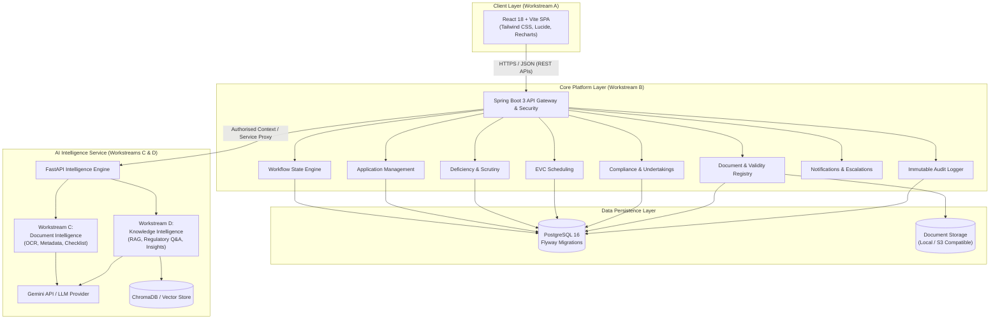

# NiyamPath — System Architecture Specification

> **Version:** 1.0  
> **Status:** Baseline Approved  
> **Team:** AlgoRise | **SIH 2026 Problem Statement 26262**

---

## 1. Architectural Vision & Topology

NiyamPath is an enterprise-grade regulatory workflow automation and compliance platform designed to manage institutional approvals, scrutiny, inspections, and ongoing compliance monitoring for the AICTE Regulation Bureau.

The system employs a **Decoupled Three-Tier Gateway Topology**:

---

## 2. Core Architectural Tenets

1. **Backend as the Authoritative State Authority:**
   - The React frontend never writes directly to the database.
   - The AI service has no direct database connection.
   - Every state transition, deficiency issuance, and compliance verification is strictly enforced and audited by the Spring Boot backend.

2. **Strict Human-in-the-Loop AI Governance:**
   - AI outputs (extracted metadata, scrutiny drafts, discrepancy flags, pendency forecasts) are advisory only.
   - The backend records AI observations in `ai_analysis_records` with status `PENDING_REVIEW`.
   - An authorized officer must explicitly validate or edit observations before they become official regulatory actions.

3. **Event-Driven Audit & Escalation:**
   - Every mutation produces an immutable `AuditEvent`.
   - Background SLA monitoring checks application ageing against configured thresholds and fires escalations to higher-level authorities when deadlines lapse.

4. **Configurable Workflows:**
   - Routing is not hardcoded. Workflows are driven by dynamic `WorkflowTemplate` definitions allowing routes such as:
     - Scrutiny Only
     - Scrutiny + EVC
     - EVC + SAC/SHC
     - Custom multi-stage review pipelines.

---

## 3. Communication Protocols & Security Boundaries

| Link | Protocol | Auth & Security | Payload Format |
|---|---|---|---|
| Frontend -> Backend | HTTPS / REST | JWT Bearer Token / Session RBAC | JSON (`ApiResponse<T>`) |
| Backend -> Database | JDBC / TLS | PostgreSQL Credentials | Relational SQL / ORM |
| Backend -> AI Service | HTTP/2 REST (Internal) | Pre-shared API Key & Context Scrubbing | JSON (Pydantic Schemas) |
| AI Service -> LLM Provider | HTTPS REST | TLS 1.3, API Key via Environment | REST / Streaming JSON |

---

## 4. Workstream Boundaries

- **Workstream A (`/frontend`):** Interface, routing, state adapters, role-tailored dashboards.
- **Workstream B (`/backend`):** Business logic, state machines, database persistence, security, AI proxy.
- **Workstream C (`/ai-service/app/document_intelligence`):** Document processing, OCR, metadata, scrutiny drafting.
- **Workstream D (`/ai-service/app/knowledge_intelligence`):** Regulatory RAG, Q&A, application summarization, pendency analytics.

